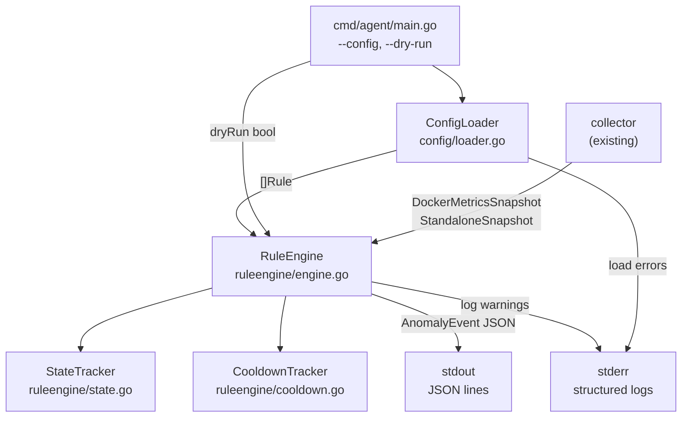
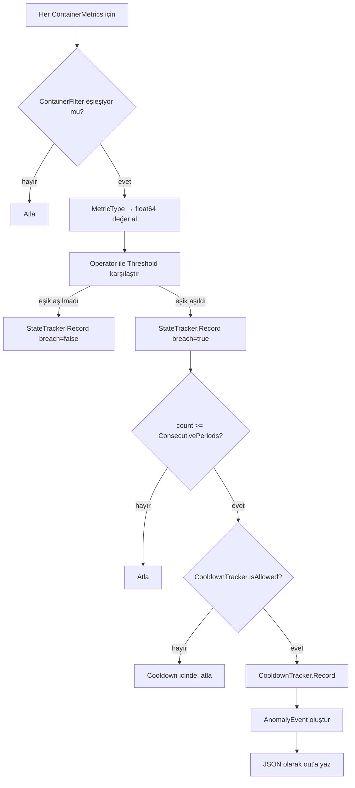

# Tasarım Dokümanı: Rule Engine ve Anomaly Detection

## Overview

Bu doküman, Zeropulse ajanına eklenecek **kural motoru (Rule Engine)** ve **anomali tespit (Anomaly Detection)** sisteminin teknik tasarımını açıklar.

Zeropulse şu anda Docker ve Standalone ortamlarından her 5 saniyede bir metrik toplayıp JSON olarak `stdout`'a yazmaktadır. Bu özellik, ham metrik akışını gerçek zamanlı kural değerlendirmesine bağlar: kullanıcı tanımlı eşikler aşıldığında `AnomalyEvent` üretir; dry-run modunda aksiyonları loglar, remediation modunda gerçekten uygular.

### Temel Tasarım Kararları

- **Sıfır harici bağımlılık**: Kural değerlendirmesi tamamen bellekte gerçekleşir; disk ve ağ I/O yok.
- **YAML-first konfigürasyon**: Operatörler kural tanımını kod değiştirmeden yönetir. JSON da desteklenir.
- **Senkron değerlendirme**: Kural motoru, metrik toplama goroutine'iyle aynı goroutine üzerinde çalışır; ek goroutine veya kanal yönetimi gerekmez.
- **Savunmacı yürütme**: Tek bir kural değerlendirmesindeki panic, diğer kuralları etkilemez; `recover()` ile yakalanır.
- **Harici YAML kütüphanesi**: `gopkg.in/yaml.v3` — Go ekosisteminde standart, iyi test edilmiş kütüphane.

---

## Architecture



### Paket Yapısı

```
zeropulse-agent/
├── cmd/agent/
│   └── main.go                  (var; --config, --dry-run flag'leri eklenir)
├── internal/
│   ├── collector/               (mevcut; değişmez)
│   ├── config/
│   │   ├── model.go             (Rule, MetricType, Operator, Action tipleri)
│   │   ├── loader.go            (ConfigLoader: YAML/JSON okuma + doğrulama)
│   │   └── loader_test.go
│   └── ruleengine/
│       ├── engine.go            (RuleEngine: Evaluate metodu)
│       ├── state.go             (StateTracker)
│       ├── cooldown.go          (CooldownTracker)
│       ├── metrics.go           (MetricType → float64 eşleme yardımcısı)
│       ├── event.go             (AnomalyEvent yapısı + JSON marshaling)
│       ├── engine_test.go
│       ├── state_test.go
│       └── cooldown_test.go
```

---

## Components and Interfaces

### ConfigLoader

```go
// internal/config/loader.go

type ConfigLoader struct{}

// Load bir dosya yolundan YAML veya JSON konfigürasyonu okur.
// Geçersiz kuralları atlar, uyarıları logger'a yazar.
// Dosya bulunamazsa veya ayrıştırılamazsa error döner.
func (c *ConfigLoader) Load(path string, logger *slog.Logger) ([]Rule, error)
```

Yükleme adımları:

1. Uzantıya göre format tespiti (`.yaml`, `.yml` → YAML; `.json` → JSON; diğer → YAML denenip hata verilir).
2. `os.ReadFile` ile ham içerik okunur.
3. İçerik ilgili decoder ile `rawConfig` struct'ına ayrıştırılır.
4. Her kural `Rule.Validate()` ile doğrulanır; geçersiz kurallar uyarıyla atlanır.
5. Geçerli kuralların listesi döndürülür.

### Rule (Veri Modeli)

```go
// internal/config/model.go

type MetricType string
const (
    MetricCPUPercent         MetricType = "CPU_PERCENT"
    MetricMemPercent         MetricType = "MEM_PERCENT"
    MetricCPUThrottledPeriods MetricType = "CPU_THROTTLED_PERIODS"
    MetricNetRxBytes         MetricType = "NET_RX_BYTES"
    MetricNetTxBytes         MetricType = "NET_TX_BYTES"
)

type Operator string
const (
    OperatorGT  Operator = "GT"
    OperatorGTE Operator = "GTE"
)

type Action string
const (
    ActionRestart Action = "RESTART"
    ActionNotify  Action = "NOTIFY"
    ActionScale   Action = "SCALE"
)

type Rule struct {
    Name               string     `yaml:"name"                json:"name"`
    MetricType         MetricType `yaml:"metric_type"         json:"metric_type"`
    Operator           Operator   `yaml:"operator"            json:"operator"`
    Threshold          float64    `yaml:"threshold"           json:"threshold"`
    ConsecutivePeriods int        `yaml:"consecutive_periods" json:"consecutive_periods"`
    Action             Action     `yaml:"action"              json:"action"`
    CooldownSeconds    int        `yaml:"cooldown_seconds"    json:"cooldown_seconds"`
    ContainerFilter    string     `yaml:"container_filter"    json:"container_filter"`
}

// Validate kuralın tüm alanlarını doğrular.
// Hata varsa açıklayıcı error döner.
func (r Rule) Validate() error
```

`Validate()` kontrolleri:
- `Name` boş olamaz
- `MetricType` bilinen değerlerden biri olmalı
- `Operator` bilinen değerlerden biri olmalı
- `Threshold >= 0`
- `ConsecutivePeriods >= 1`
- `CooldownSeconds >= 0`
- `Action` bilinen değerlerden biri olmalı

### AnomalyEvent

```go
// internal/ruleengine/event.go

type AnomalyEvent struct {
    Timestamp        time.Time `json:"timestamp"`
    EventType        string    `json:"event_type"`       // sabit: "anomaly"
    Mode             string    `json:"mode"`             // "dry-run" | "remediation"
    ContainerID      string    `json:"container_id"`
    ContainerName    string    `json:"container_name"`
    RuleName         string    `json:"rule_name"`
    MetricType       string    `json:"metric_type"`
    CurrentValue     float64   `json:"current_value"`
    Threshold        float64   `json:"threshold"`
    ConsecutiveCount int       `json:"consecutive_count"`
    Action           string    `json:"action"`
    DryRun           bool      `json:"dry_run"`
}
```

### StateTracker

```go
// internal/ruleengine/state.go

// stateKey bir (RuleName, ContainerID) çiftini temsil eder.
type stateKey struct {
    RuleName    string
    ContainerID string
}

type StateTracker struct {
    counts map[stateKey]int
}

func NewStateTracker() *StateTracker

// Record bir periyot sonucunu kaydeder.
// breach=true ise sayacı artırır, false ise sıfırlar.
// Sayacın mevcut değerini döner.
func (s *StateTracker) Record(ruleName, containerID string, breach bool) int

// Purge artık listede olmayan container'lar için durumu temizler.
func (s *StateTracker) Purge(activeContainerIDs map[string]struct{})
```

### CooldownTracker

```go
// internal/ruleengine/cooldown.go

type CooldownTracker struct {
    lastFired map[stateKey]time.Time
    now       func() time.Time // test edilebilirlik için enjekte edilebilir
}

func NewCooldownTracker() *CooldownTracker

// IsAllowed belirli bir (rule, container) çifti için aksiyonun
// şu an tetiklenip tetiklenmeyeceğini kontrol eder.
// Eğer cooldown dolmamışsa false döner.
func (c *CooldownTracker) IsAllowed(ruleName, containerID string, cooldownSecs int) bool

// Record başarılı bir tetiklenme zamanını kaydeder.
func (c *CooldownTracker) Record(ruleName, containerID string)

// Purge artık aktif olmayan container'lar için kayıtları temizler.
func (c *CooldownTracker) Purge(activeContainerIDs map[string]struct{})
```

### RuleEngine

```go
// internal/ruleengine/engine.go

type RuleEngine struct {
    rules   []config.Rule
    state   *StateTracker
    cooldown *CooldownTracker
    dryRun  bool
    out     io.Writer        // AnomalyEvent JSON çıkışı (normalde os.Stdout)
    logger  *slog.Logger
}

func NewRuleEngine(rules []config.Rule, dryRun bool, out io.Writer, logger *slog.Logger) *RuleEngine

// EvaluateDocker bir DockerMetricsSnapshot için tüm kuralları değerlendirir.
func (e *RuleEngine) EvaluateDocker(snap *collector.DockerMetricsSnapshot)

// EvaluateStandalone bir StandaloneSnapshot için tüm kuralları değerlendirir.
func (e *RuleEngine) EvaluateStandalone(snap *collector.StandaloneSnapshot)
```

#### Evaluate Akış Şeması



### MetricType Eşleme Yardımcısı

```go
// internal/ruleengine/metrics.go

// ExtractDockerMetricValue bir ContainerMetrics'ten MetricType'a karşılık gelen değeri döner.
// Bilinmeyen MetricType için hata döner.
func ExtractDockerMetricValue(m collector.ContainerMetrics, mt config.MetricType) (float64, error)

// ExtractStandaloneMetricValue bir StandaloneSnapshot'tan değeri döner.
// Standalone modda desteklenmeyen metrik tiplerinde hata döner.
func ExtractStandaloneMetricValue(snap *collector.StandaloneSnapshot, mt config.MetricType) (float64, error)
```

Standalone modda `CPU_THROTTLED_PERIODS`, `NET_RX_BYTES`, `NET_TX_BYTES` desteklenmez; bu metrik tiplerini içeren kurallar yükleme sırasında uyarıyla filtrelenir.

---

## Data Models

### Konfigürasyon Dosyası (YAML)

```yaml
rules:
  - name: "high-cpu-alert"
    metric_type: "CPU_PERCENT"
    operator: "GTE"
    threshold: 85.0
    consecutive_periods: 3
    action: "NOTIFY"
    cooldown_seconds: 60
    container_filter: ""
```

### AnomalyEvent JSON Çıktısı

```json
{
  "timestamp": "2025-01-15T10:23:45.123Z",
  "event_type": "anomaly",
  "mode": "dry-run",
  "container_id": "a3f1b2c4d5e6",
  "container_name": "api-server",
  "rule_name": "high-cpu-alert",
  "metric_type": "CPU_PERCENT",
  "current_value": 91.5,
  "threshold": 85.0,
  "consecutive_count": 3,
  "action": "NOTIFY",
  "dry_run": true
}
```

### Bellek İçi Durum

`StateTracker` ve `CooldownTracker` kalıcı depolama kullanmaz. Ajan yeniden başladığında her iki tracker da sıfır sayaçlarla başlatılır. Bu, bilerek alınmış bir tasarım kararıdır: kural motoru restart sonrasında yeniden "ısınma" sürecine girer, ancak kalıcı durum yönetiminin getireceği karmaşıklıktan (serialization, migration, disk I/O) kaçınılmış olur.

### Standalone Mod — Konteyner Kimliği

Standalone modda `ContainerID` alanı sabit `"host"` değerini, `ContainerName` alanı ise `os.Hostname()` sonucunu içerir. StateTracker ve CooldownTracker bu sabit kimlikle çalışır.

---

## Correctness Properties

*A property is a characteristic or behavior that should hold true across all valid executions of a system — essentially, a formal statement about what the system should do. Properties serve as the bridge between human-readable specifications and machine-verifiable correctness guarantees.*

### Property 1: Kural Doğrulama — Geçersiz ConsecutivePeriods Reddi

*For any* `Rule` where `ConsecutivePeriods < 1`, `Rule.Validate()` SHALL return a non-nil error.

**Validates: Requirements 1.2**

---

### Property 2: Kural Doğrulama — Geçersiz CooldownSeconds Reddi

*For any* `Rule` where `CooldownSeconds < 0`, `Rule.Validate()` SHALL return a non-nil error.

**Validates: Requirements 1.3**

---

### Property 3: Kural Doğrulama — Negatif Threshold Reddi

*For any* `Rule` where `Threshold < 0`, `Rule.Validate()` SHALL return a non-nil error.

**Validates: Requirements 1.4**

---

### Property 4: ContainerFilter Eşleşme Davranışı

*For any* container name and any `Rule`, if the rule's `ContainerFilter` is empty, the rule SHALL apply to that container. If `ContainerFilter` is non-empty, the rule SHALL apply only if the container name equals the filter value.

**Validates: Requirements 1.5, 1.6**

---

### Property 5: AnomalyEvent Zorunlu Alan Bütünlüğü

*For any* rule violation that produces an `AnomalyEvent`, the event SHALL contain non-zero values for all required fields: `Timestamp`, `ContainerID`, `ContainerName`, `RuleName`, `MetricType`, `CurrentValue`, `Threshold`, `ConsecutiveCount`, `Action`, `DryRun`.

**Validates: Requirements 2.1**

---

### Property 6: DryRun Modu Etiketi

*For any* `AnomalyEvent`, if `DryRun` is `true` then `Mode` SHALL equal `"dry-run"`; if `DryRun` is `false` then `Mode` SHALL equal `"remediation"`.

**Validates: Requirements 2.4, 2.5**

---

### Property 7: StateTracker — Ardışık Sayaç Doğruluğu

*For any* sequence of `Record` calls on a `StateTracker` for the same `(RuleName, ContainerID)` pair, the returned count after a `breach=true` call SHALL equal the number of consecutive `breach=true` calls since the last `breach=false` call (or since initialization).

**Validates: Requirements 3.1, 3.2**

---

### Property 8: StateTracker — Tetikleme Eşiği

*For any* rule with `ConsecutivePeriods = N` and any sequence of `N` or more consecutive breaches recorded in `StateTracker`, the count returned SHALL be `>= N`, which triggers anomaly emission.

**Validates: Requirements 3.3**

---

### Property 9: CooldownTracker — Cooldown İçinde Atla

*For any* `(RuleName, ContainerID)` pair where an action was just recorded and `CooldownSeconds > 0`, calling `IsAllowed` within `CooldownSeconds` seconds SHALL return `false`.

**Validates: Requirements 4.2**

---

### Property 10: CooldownTracker — Sıfır Cooldown Her Zaman İzin Verir

*For any* `(RuleName, ContainerID)` pair with `CooldownSeconds = 0`, `IsAllowed` SHALL always return `true` regardless of previous invocations.

**Validates: Requirements 4.3**

---

### Property 11: Kural Değerlendirme Kapsamı

*For any* `DockerMetricsSnapshot` with N containers and M rules, `EvaluateDocker` SHALL evaluate all N × M (rule, container) combinations (subject to ContainerFilter).

**Validates: Requirements 5.1**

---

### Property 12: Panic İzolasyonu

*For any* evaluation cycle where one rule's evaluation causes a panic, all remaining rules SHALL still be evaluated and their results processed normally.

**Validates: Requirements 5.4**

---

### Property 13: MetricType → Alan Eşleme Doğruluğu

*For any* `ContainerMetrics` and any known `MetricType`, `ExtractDockerMetricValue` SHALL return the value of exactly the field that corresponds to that `MetricType` (CPU_PERCENT → CPUPercent, MEM_PERCENT → MemPercent, CPU_THROTTLED_PERIODS → CPUThrottledPeriods, NET_RX_BYTES → NetRxBytes, NET_TX_BYTES → NetTxBytes).

**Validates: Requirements 6.1, 6.2, 6.3, 6.4, 6.5**

---

### Property 14: Bilinmeyen MetricType — Doğrulama Hatası

*For any* `Rule` where `MetricType` is not one of the five defined values, `Rule.Validate()` SHALL return a non-nil error.

**Validates: Requirements 6.6**

---

### Property 15: Konfigürasyon Round-Trip (YAML)

*For any* valid `[]Rule` value, serializing to YAML and then parsing back SHALL produce a `[]Rule` that is element-wise equivalent to the original.

**Validates: Requirements 10.3, 10.4**

---

## Error Handling

### Konfigürasyon Yükleme Hataları

| Durum | Davranış |
|---|---|
| Dosya bulunamadı | `stderr`'e hata logu, sıfır olmayan exit kodu |
| Geçersiz YAML/JSON sözdizimi | `stderr`'e hata logu (satır/alan bilgisiyle), sıfır olmayan exit kodu |
| Geçersiz kural alanı | Kural atlanır, `stderr`'e uyarı logu yazılır, devam edilir |
| Sıfır geçerli kural | Uyarı logu, metrik toplama devam eder, kural değerlendirmesi çalışmaz |

### Çalışma Zamanı Hataları

| Durum | Davranış |
|---|---|
| Kural değerlendirmesinde panic | `recover()` ile yakalanır, `stderr`'e hata logu, diğer kurallar değerlendirilmeye devam eder |
| `AnomalyEvent` JSON encode hatası | `stderr`'e hata logu, diğer olaylar etkilenmez |
| Docker API başarısız (MetricsSnapshot alınamadı) | Mevcut davranış korunur: `stderr`'e log, döngü devam eder |
| Standalone modda desteklenmeyen MetricType | Kural yükleme sırasında uyarıyla filtrelenir; runtime'da bu kuralla karşılaşılmaz |

### Hata Propagation Stratejisi

Kural motoru `EvaluateDocker`/`EvaluateStandalone` metodlarından hata döndürmez. Tüm hatalar loglanır ve evaluation devam eder. Bu, tek bir hatalı kuralın tüm izleme döngüsünü durdurmasını önler.

---

## Testing Strategy

### Yaklaşım

İki katmanlı test stratejisi:

1. **Unit testler**: Belirli örnekleri, sınır koşullarını ve hata durumlarını doğrular.
2. **Property-based testler**: Geniş rastgele girdi alanında evrensel özellikleri doğrular.

Property-based testing kütüphanesi: [`github.com/flyingmutant/rapid`](https://github.com/flyingmutant/rapid) — Go için geliştirilmiş, shrinking destekli PBT kütüphanesi.

Her property testi minimum **100 iterasyon** çalıştırır.

### Property-Based Testler

Her property-based test, design dokümanındaki karşılığına referans veren bir yorum içermelidir:

```
// Feature: rule-engine-and-anomaly-detection, Property N: <property_text>
```

| Test | Property | Paket |
|---|---|---|
| `TestValidateConsecutivePeriodsInvalid` | Property 1 | `config` |
| `TestValidateCooldownSecondsNegative` | Property 2 | `config` |
| `TestValidateThresholdNegative` | Property 3 | `config` |
| `TestContainerFilterMatching` | Property 4 | `ruleengine` |
| `TestAnomalyEventFieldCompleteness` | Property 5 | `ruleengine` |
| `TestDryRunModeLabel` | Property 6 | `ruleengine` |
| `TestStateTrackerConsecutiveCount` | Property 7 | `ruleengine` |
| `TestStateTrackerTriggerThreshold` | Property 8 | `ruleengine` |
| `TestCooldownBlocksWithinWindow` | Property 9 | `ruleengine` |
| `TestZeroCooldownAlwaysAllows` | Property 10 | `ruleengine` |
| `TestEvaluateAllCombinations` | Property 11 | `ruleengine` |
| `TestPanicIsolation` | Property 12 | `ruleengine` |
| `TestMetricTypeMapping` | Property 13 | `ruleengine` |
| `TestUnknownMetricTypeValidation` | Property 14 | `config` |
| `TestConfigRoundTripYAML` | Property 15 | `config` |

### Unit Testler

Unit testler aşağıdaki senaryolara odaklanır:

- **ConfigLoader**: Dosya bulunamadı, geçersiz YAML, sıfır kural, YAML ve JSON yükleme.
- **RuleEngine.EvaluateDocker**: Eşik tam eşitlik (GT vs GTE farkı), ConsecutivePeriods=1 anında tetikleme, cooldown geçince yeniden tetikleme, Standalone modda desteklenmeyen metrik tipi.
- **StateTracker.Purge**: Aktif olmayan container'ların temizlenmesi.
- **CooldownTracker.Purge**: Stale kayıtların temizlenmesi.
- **AnomalyEvent JSON**: `mode` alanının doğruluğu, `event_type: "anomaly"` sabitinin varlığı.

### Integration Testleri

- `main.go` entegrasyonu: `--dry-run` bayrağının `DryRun=true` ürettiğini doğrula (mock collector ile).
- End-to-end: Konfigürasyon dosyası → kural yükleme → sahte snapshot → `AnomalyEvent` çıktısı doğrulaması.
- Standalone mod: `"host"` ContainerID ve `hostname` ContainerName kullanımı.
